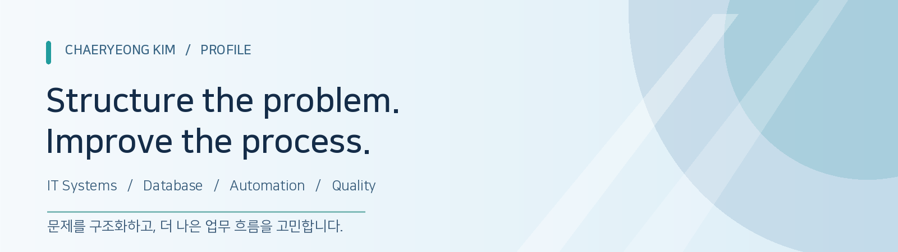

[README.md](https://github.com/user-attachments/files/33924250/README.md)

  

  <h2>김채령 · Chaeryeong Kim</h2>
  
<strong>IT Systems & Process Improvement</strong>

  
기술을 통해 시스템과 업무 흐름을 이해하고, 실질적인 개선 방법을 고민합니다.

  

    <a href="https://github.com/kimxchae23">GitHub</a> &nbsp;·&nbsp;
    <a href="https://YOUR_PORTFOLIO.vercel.app">Portfolio</a> &nbsp;·&nbsp;
    <a href="mailto:YOUR_EMAIL@example.com">Email</a>
  

---

## 01. About Me

안녕하세요. 컴퓨터·AI를 전공하며 **백엔드 구현, 데이터베이스 설계, 소프트웨어 검증, 업무 자동화**를 경험해 온 김채령입니다.

기능을 만드는 것에 그치지 않고, **요구사항과 데이터 흐름을 이해하고 반복적인 업무를 더 효율적으로 만드는 과정**에 관심이 있습니다. 팀 프로젝트에서 인증·데이터 관리 기능을 구현했고, 소프트웨어 V&V 인턴십에서는 요구사항과 설계 산출물의 연결성을 검토하며 문서 비교 자동화를 시도했습니다.

현재는 **기업 정보시스템(ERP), IT 운영, 데이터 관리, 프로세스 개선** 분야로 관심을 넓히고 있습니다.

## 02. What I Focus On

| Focus | How I approach it |
|:--|:--|
| **System Thinking** | 요구사항, 설계, 데이터 간 연결 관계를 이해합니다. |
| **Process Improvement** | 반복되는 업무에서 개선 가능한 단계를 찾아봅니다. |
| **Data Management** | 데이터 구조와 흐름을 명확하게 설계하고 관리합니다. |
| **Quality & Reliability** | 구현 결과가 요구사항과 일치하는지 검토합니다. |

## 03. Featured Projects

<table>
<tr>
<td width="50%" valign="top">

### 01 · AI-Assisted Coding Platform
**AI 기반 코딩 학습 플랫폼**

사용자 인증 기능과 데이터 관리 구조를 구현하고 반복적인 데이터 수집을 자동화했습니다.

**My Contribution**  
인증 구현 · Supabase 스키마 설계 · 데이터 크롤링

**Tech** `Spring Boot` `Supabase` `Python`

<!-- 공개 가능한 저장소가 준비되면 아래 문구를 링크로 바꾸세요. -->
*Repository: 공개 준비 중*

</td>
<td width="50%" valign="top">

### 02 · AI Rehabilitation Assistant
**재활치료 보조 애플리케이션**

MediaPipe 기반 관절 데이터 분석을 통해 운동 자세 정확도와 피드백을 다루는 프로젝트입니다.

**Focus**  
관절 좌표 분석 · 자세 정확도 평가 · 리포트

**Tech** `Python` `MediaPipe`

*Repository: 공개 준비 중*

</td>
</tr>
<tr>
<td width="50%" valign="top">

### 03 · Traceability Automation
**요구사항 추적성 검토 자동화**

SRS/SDD 개정 내용을 비교하고 Excel 추적성표의 검토 작업을 보조하는 자동화를 시도했습니다.

**My Contribution**  
문서 비교 로직 · 변경사항 분류 · Excel 결과 반영

**Tech** `Python` `python-docx` `openpyxl`

*업무상 비공개 자료와 분리하여 공개 가능한 예제로 재구성 예정*

</td>
<td width="50%" valign="top">

### 04 · Spring Web Application
**Spring 기반 웹 서비스**

사용자 계정 관리와 데이터 저장 기능을 구현하며 서버와 DB 간 연동을 경험했습니다.

**Focus**  
로그인 · 회원가입 · DB 연동

**Tech** `Java` `Spring Boot` `MySQL`

*Repository: 공개 준비 중*

</td>
</tr>
</table>

> 팀 프로젝트는 실제 기여 범위를 명확하게 표시하고, Private 저장소의 코드·이미지는 팀원과 소유자의 공개 동의를 받은 뒤 게시합니다.

## 04. Technical Skills

| Category | Technologies |
|:--|:--|
| **Languages** | Python · Java · C · SQL |
| **Backend** | Spring Boot · JPA |
| **Database** | MySQL · Supabase |
| **Infrastructure & Tools** | AWS EC2 · Docker · Git · GitHub Actions |
| **Document Automation** | python-docx · openpyxl |

*실제 프로젝트 또는 업무에서 사용한 기술을 중심으로 정리했습니다.*

## 05. Experience

**Software Verification & Validation Intern — 슈어소프트테크, 에너지검증3팀**

- SRS/SDD 등 요구사항·설계 문서의 추적성 및 정합성 검토
- 산출물 간 불일치 사항과 개정 내용 확인
- Python 기반 Word/Excel 문서 비교 자동화 시도

**What I learned:** 문제를 정확하게 정의하고, 요구사항부터 검증 결과까지 연결해 보는 과정의 중요성.

## 06. How I Work

**Understand → Structure → Improve → Validate**

1. **Understand** — 요구사항과 현재 흐름을 먼저 파악합니다.
2. **Structure** — 정보의 관계와 문제의 원인을 정리합니다.
3. **Improve** — 반복 작업을 줄이거나 더 나은 방법을 시도합니다.
4. **Validate** — 변화가 실제로 도움이 되는지 확인합니다.

## 07. Currently Exploring

`ERP & Enterprise IT` &nbsp; `Database & SQL` &nbsp; `IT Operations` &nbsp; `Workflow Automation`

---

  Better systems begin with understanding the problem.

